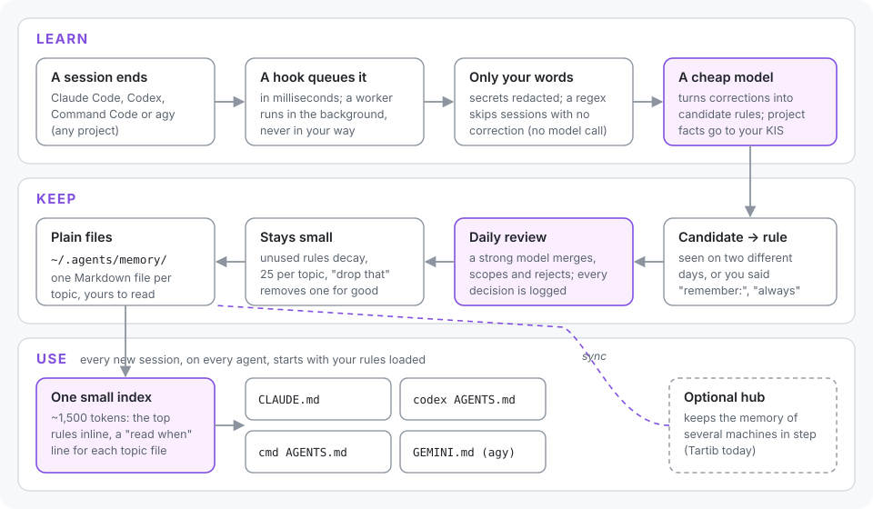

<p align="center">
  
</p>

<h1 align="center">lore</h1>

<p align="center">
  <b>One memory for every coding agent.</b><br>
  Correct Claude Code once, and Codex, Command Code and agy already know it next session.<br>
  lore learns your preferences and hard-won lessons on its own, keeps them small, and loads them everywhere.
</p>

<p align="center">
  <a href="https://github.com/smkamranqadri/lore-skill/actions/workflows/test.yml"></a>
  <a href="LICENSE"></a>
  
  
  
</p>

---

You tell Claude "no, use pnpm". Next week Codex runs `npm install` in another repo. You explain
it again. Every agent has its own memory, if any, and none of them talk to each other.

**lore fixes that.** It watches for the moments you correct an agent, turns them into short
rules, and puts the strongest ones in front of every agent you use, in every project. You do not
run a retro or maintain a notes file. Saying "remember:" is optional.

<p align="center">
  
</p>

## Contributing

lore is young, and the most useful help right now is:

- **Try it** with your agents and [open an issue](https://github.com/smkamranqadri/lore-skill/issues) for anything that surprised you.
- **Add an agent.** Each one is a single adapter file; see [Adding an agent](docs/adding-an-agent.md).
- **Improve the filters.** Better correction detection or review prompts, each backed by a test.

Read [CONTRIBUTING.md](CONTRIBUTING.md) before your first pull request. If lore saves you time,
a star helps other people find it.

**Details:** [How it works](docs/how-it-works.md) · [Configuration](docs/configuration.md) ·
[Adding an agent](docs/adding-an-agent.md) · [Privacy and safety](#privacy-and-safety) ·
[FAQ](#faq) · [Changelog](CHANGELOG.md)

## Quick start

```bash
curl -fsSL https://raw.githubusercontent.com/smkamranqadri/lore-skill/main/bootstrap.sh \
  | bash -s -- install --repo https://github.com/smkamranqadri/lore-skill.git
python3 ~/.agents/skills/lore/scripts/lore.py setup
```

`setup` finds the agents installed on your machine, shows every file it will change, backs them
up, and asks before writing. That is the whole installation. If you use Codex, open `/hooks` once
inside Codex and trust lore's hooks (Codex asks for this for any new hook).

Requirements: macOS or Linux, Python 3, and at least one of the supported agents.

## What you get

- **It learns without being asked.** When a session ends, lore reads only your own messages,
  skips the ones that are not corrections, and asks a cheap model to turn the rest into rules.
  Most sessions cost nothing at all.
- **It does not learn the wrong thing from one bad day.** A new rule waits until you have shown
  it on two different days, or until you say "remember:", "always" or "never". Once a day a
  stronger model reviews what is new: it merges duplicates, settles contradictions and rejects
  noise. Every decision is logged with its reason.
- **It stays small.** Every agent loads one index of about 1,500 tokens: your strongest rules in
  full, plus one "read when" line per topic. Unused rules fade; each topic holds at most 25.
- **It works the same everywhere.** One memory for Claude Code, Codex, Command Code and agy, on
  every project, and optionally on every machine you work on.
- **It is yours.** Plain Markdown files in `~/.agents/memory/`. Read them, grep them, keep them
  in git. Nothing is sent anywhere except to the model CLIs you already use.

## Supported agents

| Agent | Loads the index from | Learns from |
| --- | --- | --- |
| Claude Code | `~/.claude/CLAUDE.md` (an import line) | session end and compaction |
| Codex | `~/.codex/AGENTS.md` | session end and compaction |
| Command Code | `~/.commandcode/AGENTS.md` (an import line) | each finished turn, once the session goes quiet |
| agy (Google Antigravity CLI) | `~/.gemini/GEMINI.md` | each finished turn, once the session goes quiet |

lore only ever edits the text between its own `<!-- lore:index -->` markers, and it adds its hooks
next to yours without touching them. `setup --remove` takes it all out again.

## Everyday use

You mostly do nothing. When you want to steer it:

| You say to any agent | What happens |
| --- | --- |
| "remember: always run the tests before committing" | the rule is saved now and every agent has it next session |
| "drop that" (about a rule the index shows as New) | the rule is deleted and never learned again |
| "what does lore know about git?" | the agent lists that topic's rules |
| `/lore:learn-taste` | lore also learns from Command Code's taste files |

New rules appear for a week under **New** in the index, so you can see what lore learned and veto it.

## Privacy and safety

- Your memory is local plain text. lore has no server and no account.
- Before any text reaches a model, lore redacts strings that look like secrets (API keys, tokens,
  private keys, `password=` values), and it refuses to store a rule that still looks like one.
- lore reads only your messages, never tool output or files, and it never stores facts about one
  project (its stack, paths or deploy steps). It notes those for that project's own memory instead.
- Extraction and review go through the agent CLIs you already have, with their own hooks turned
  off. The models are named in each adapter file and you can change them.
- `setup` backs up every file it touches. See [SECURITY.md](SECURITY.md) to report a problem.

## How lore compares

| | lore | Claude Code auto memory | Codex memories | Command Code taste | A hand-kept AGENTS.md |
| --- | --- | --- | --- | --- | --- |
| Shared across agents | **all four** | Claude only | Codex only | Command Code only | per tool |
| Shared across projects | **yes** | per project | yes | per project | per project |
| Learns on its own | **yes** | yes | yes | yes | no |
| Guards against wrong lessons | **two days or explicit, daily review, decay** | the model decides | background summary | confidence, decay | you decide |
| Size in every session | **~1.5k tokens, capped** | up to 200 lines | varies | varies | whatever you write |
| Format | **plain Markdown you own** | Markdown | internal | Markdown | Markdown |

lore does not replace your project's own instructions. It holds what is true in every project.

## FAQ

**Does it slow my agents down?** No. The hook queues the session and returns in milliseconds; the
work happens in the background after the session ends.

**What does it cost?** Sessions without a correction cost nothing. A session with one costs a
single short call to a cheap model (Codex or Claude Haiku at low effort by default). The daily
review is one call to a stronger model. All of this runs on the agent subscriptions you already have.

**Can it learn something wrong?** It can, and that is why a rule needs two separate days (or your
explicit word), a stronger model reviews new rules daily, unused rules fade, and you can say
"drop that". Everything is logged in `~/.agents/memory/review.log`.

**Can I use it on two machines?** Yes, with a notes hub. Today the hub is
[Tartib](https://github.com/smkamranqadri/tartib), synced by your agent over its MCP; see
[Configuration](docs/configuration.md). Without a hub, lore works fully on one machine.

**How do I undo it?** `python3 ~/.agents/skills/lore/scripts/lore.py setup --remove` takes lore
out of every agent and keeps your memory; delete `~/.agents/memory/` if you want that gone too.

**Why not just a big AGENTS.md?** Because nobody keeps it up to date, and because research on
agent context files finds that long ones cost more and help less. lore keeps the loaded part
small and lets the rest live in topic files the agent reads only when they matter.

## Development

```bash
git clone https://github.com/smkamranqadri/lore-skill.git && cd lore-skill
tests/run.sh                        # every suite runs in a temporary HOME
./bootstrap.sh install --source .   # install your working copy
```

This repository also carries its own project memory in `kis/`, written while lore was built.

## License

[MIT](LICENSE)
